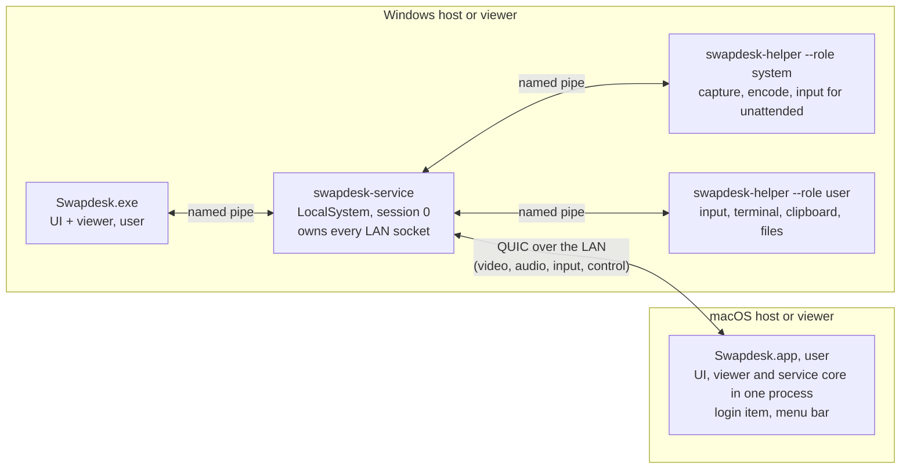

# Swapdesk

A remote desktop that works only on your local network, for Windows and macOS, built for every direction: Windows to Windows, Windows to Mac, Mac to Windows and Mac to Mac. Written in Rust with a native interface on each OS. Licensed MIT OR Apache-2.0.

> **Status: version 1.0.0.** A Windows PC and a Mac control each other across a real LAN after pairing by a compared code: screen, system audio and mouse in both directions, and the keyboard from the Mac to the PC. Between two Windows PCs everything below runs, including terminal, files, clipboard, swap, chat, Wake-on-LAN and reconnect, proven with two instances on one PC. What is not in 1.0 is listed in [Not in 1.0 yet](#not-in-10-yet); the evidence for each feature is in [Status](#status).

## What it is and why

AnyDesk and TeamViewer reach your machines through a cloud. Swapdesk is for the case where both machines are yours and on the same LAN, and nothing should leave it.

The goal for version 1 (from [docs/SPEC.md](docs/SPEC.md)): screen, system audio, mouse, keyboard, terminal, files, clipboard, chat, Wake-on-LAN and unattended access between two machines. Either machine can host or control. "Inverter" ("Swap") inverts the roles when the other side accepts.

Swapdesk has no relay, no cloud, no NAT traversal and no account. Anything beyond the LAN is explicitly out of scope, not just unbuilt.

## Download

Get the zip for your system from the [latest release](https://github.com/devBertini/swapdesk/releases/latest): Windows 10 or 11 (x64) or macOS 14 or later (Apple silicon). Each zip has a `.sha256` file next to it, and the release workflow publishes a build provenance attestation for it, so with the [GitHub CLI](https://cli.github.com/) you can check that the zip was built from this repository:

```sh
gh attestation verify Swapdesk-windows-x64-1.0.0.zip -R devBertini/swapdesk
```

## Install on Windows

Requirements: Windows 10 or 11 (x64) on a local network set as **Private** (the firewall rules the installer adds cover Private and Domain profiles only).

1. Download `Swapdesk-windows-x64-1.0.0.zip` from the [releases](https://github.com/devBertini/swapdesk/releases) page and check its SHA-256 against the `.sha256` file next to it.
2. Unzip it, read `install.ps1` if you like (every change is listed in its header), and double-click `install.cmd`. Approve the Windows (UAC) prompt. It installs to `%ProgramFiles%\Swapdesk`, registers the `SwapdeskService` service, adds the firewall rules (UDP 47820, 47821 and mDNS 5353, local subnet only) and a Start menu shortcut.
3. Open **Swapdesk** from the Start menu.

`uninstall.cmd` in the same folder removes everything and checks that nothing is left. `install.cmd -DryRun` and `uninstall.cmd -DryRun` print every action without doing any.

The binaries are not code-signed (decision D22: no paid certificate). Windows SmartScreen may warn about an unknown publisher, and **Smart App Control blocks unsigned programs**: on a PC where it is on, Swapdesk does not start until it is turned off (Windows Security > App & browser control > Smart App Control). Recent Windows updates let you turn it back on there without reinstalling Windows.

## Install on macOS

Requirements: macOS 14 or later on Apple silicon.

1. Download `Swapdesk-macos-arm64-1.0.0.zip` from the [releases](https://github.com/devBertini/swapdesk/releases) page, check its SHA-256, unzip it and move **Swapdesk** to Applications.
2. The app is signed ad hoc, not with an Apple Developer ID (decision D22), so macOS refuses the first open. Open it once, then go to System Settings > Privacy & Security, find the line saying Swapdesk was blocked and click **Open Anyway**.
3. Allow what it asks for: **Local Network** (to find and reach the other computer) and, for this Mac to be controlled, **Screen & System Audio Recording** and **Accessibility**. To control another computer from the Mac, also **Input Monitoring**.

Swapdesk adds itself to Login Items and stays in the menu bar when its window is closed, so the Mac can be reached while you are logged in. macOS ties the permissions to the exact build of an ad hoc signed app: after an update, remove Swapdesk from each list in Privacy & Security and allow it again.

To uninstall on macOS: choose "Quit Swapdesk" in its menu bar item, remove Swapdesk from System Settings > General > Login Items and from each list in Privacy & Security, move the app from Applications to the Trash, and delete `~/Library/Application Support/Swapdesk` (the device key, the paired devices and the trace log).

## First connection

Open Swapdesk on both computers. The other computer appears under "Na rede" ("On the network"); if it does not, type its IPv4 address in "Adicionar por endereço" ("Add by address") and see [docs/FAQ.md](docs/FAQ.md). Pair them: both screens show the same 6-digit code; confirm it on both. Then connect: the computer being controlled asks its user to accept, and what was granted is kept per device.

The interface is in Brazilian Portuguese and English: it follows the system language, and Settings switches it.

## Status

Each feature is in one of three states, written conservatively:

- **Between machines:** proven on two separate computers on a real LAN (one Windows PC and one MacBook).
- **One PC:** proven on one Windows PC, two instances talking over loopback or through the installed service.
- **Not in 1.0:** see [Not in 1.0 yet](#not-in-10-yet).

| Feature | Mac controls Windows | Windows controls Mac | Windows to Windows |
|---|---|---|---|
| Pairing by compared code, pinned keys | Between machines | Between machines | One PC |
| Screen (capture, H.264, transport, decode, render) | Between machines | Between machines (3420x2214, first frame in 0.6 s) | One PC |
| System audio | Between machines | Between machines | One PC |
| Mouse | Between machines | Between machines | One PC |
| Keyboard | Between machines (typing into Notepad) | Built and unit-tested on the Mac, not yet run between machines | One PC |
| Add by address and the LAN guard | Between machines | Between machines | One PC |
| Discovery on the LAN (DNS-SD) | Built | Built | One PC |
| Swap, chat, Wake-on-LAN, reconnect | Not in 1.0 | Not in 1.0 | One PC |
| Terminal, files, clipboard, quick actions | Not in 1.0 | Not in 1.0 | One PC |
| Full screen and viewer shortcuts | Built | Built | One PC |
| Reachable while logged in, window closed | n/a | Login item and menu bar | Windows service |
| Unattended (login screen, lock screen, UAC) | Not in 1.0 | Not in 1.0 (macOS allows only logged-in and unlocked) | Not in 1.0 |

The runs between machines are driven by a test harness over the shipped host and viewer code, plus a manual session with the Mac controlling the PC. Windows to Windows across two separate PCs and Mac to Mac are not verified: the project has one PC and one Mac. The flow-by-flow proof map is [docs/FLUXOS.md](docs/FLUXOS.md).

**Dependencies:** the project keeps a small, audited set of third-party crates (`cargo deny` and `cargo vet` in CI); transport and cryptography stay on `quinn`, `rustls` and `ring` ([docs/DECISIONS.md](docs/DECISIONS.md), D28). Their licenses are in [THIRD-PARTY-LICENSES.md](THIRD-PARTY-LICENSES.md).

## Not in 1.0 yet

Planned for 1.1:

- Swap, terminal, files and clipboard between Windows and Mac (they work Windows to Windows).
- Unattended Windows access at the login screen, the lock screen and UAC prompts, proven across a real reboot.
- An 8-hour soak with Wi-Fi drops, with the CPU, GPU and memory budgets measured on it.
- Switching between the host's displays, proven on two displays with different scaling.
- Fewer copies on the frame path and a cached text layout in the interface.
- The next interface pass: screens, texts, accessibility, a Windows tray icon and a first-run guide.
- An installer with an entry in the installed apps list, and a signing path for both systems.
- Screenshots, a performance report, coverage-guided fuzzing of the decoders, a Linux CI job.

## How it stays on the LAN

This is enforced in code, not left to configuration ([docs/SPEC.md](docs/SPEC.md) F-FIND-02, [docs/PROTOCOL.md](docs/PROTOCOL.md) section 1):

- Physical Ethernet and Wi-Fi interfaces only. Virtual interfaces (WSL, Hyper-V, Docker), VPNs and tunnels are never announced on, browsed on or accepted on.
- A connection is refused before the TLS handshake unless the peer address is on-link in the subnet of the interface it arrived on, and is not loopback or one of this machine's own addresses.
- QUIC packets are sent with IP TTL (hop limit) 1, so they cannot be routed off the subnet. mDNS keeps TTL 255, as link-local multicast requires.
- A manually typed address is accepted only if it is on-link.
- No relay, no cloud and no NAT traversal exist in the design.

## Security in brief

Full detail is in [docs/THREAT-MODEL.md](docs/THREAT-MODEL.md).

- **Pairing by comparing a 6-digit code.** Both users open "Parear este computador" ("Pair this computer") within 2 minutes. Both screens show the same code, derived from a commitment exchange and both keys (ZRTP-style, RFC 6189 argument). A key is pinned only after both users confirm the codes match. Three failed attempts in 15 minutes lock pairing for 15 minutes, and each further lockout within 24 hours doubles that, up to 24 hours.
- **Pinned keys.** Each machine has one Ed25519 device key. Sessions use TLS 1.3 with mutual authentication and only pinned keys. No session tickets and no 0-RTT are accepted, and the key is checked again after every handshake.
- **Permissions per device and direction.** `VIEW`, `CONTROL`, `AUDIO`, `TERMINAL`, `ADMIN_TERMINAL`, `FILES`, `CLIPBOARD`, `UNATTENDED`. A newly paired device has none, so every session prompts the host's user until more is granted.
- **Admin-only unattended access.** Granting `UNATTENDED` or `ADMIN_TERMINAL` needs a local administrator (UAC elevation on Windows, an authorization right on macOS), checked by the privileged service, never by the interface.
- On Windows the private key stays in the privileged service; on macOS it is a file readable only by the logged-in user (decision D31). The viewer, the terminal and file access run as the logged-in user, never as SYSTEM or root.

Report vulnerabilities as described in [SECURITY.md](SECURITY.md).

## Architecture



On Windows the service owns every LAN socket in both roles, so the private key never leaves it and the LAN guard lives in one place. On macOS, version 1 runs the same service core inside the app as the logged-in user (decisions D27 and D32); a root daemon is future work. On the viewer side, media reaches the interface over local IPC. Details, privilege boundaries and the media pipelines are in [docs/ARCHITECTURE.md](docs/ARCHITECTURE.md). The wire format is [docs/PROTOCOL.md](docs/PROTOCOL.md).

## Build and test (Windows)

Requirements:

- Rust stable, as pinned by [rust-toolchain.toml](rust-toolchain.toml) (channel `stable`, with `rustfmt` and `clippy`). The workspace sets `rust-version = "1.99"` and edition 2024 in [Cargo.toml](Cargo.toml).
- Visual Studio 2022 Build Tools and the Windows SDK.
- [cargo-nextest](https://nexte.st/): `cargo install cargo-nextest`.
- The `opus` crate builds libopus with CMake, and a long build path can break that build on Windows: if a build fails on path length, use a short `CARGO_TARGET_DIR`.

```sh
cargo nextest run --workspace          # the unit tests
cargo build --release                  # UI, helpers (panic = abort)
cargo build -p swapdesk-service --profile release-service   # service (panic = unwind)
```

The service is built with its own profile because it must isolate a panic to one session, while the interface and helpers abort (decision D15 in [docs/DECISIONS.md](docs/DECISIONS.md)).

### Development mode

The real service runs as LocalSystem under the Service Control Manager and needs the elevated install in [packaging/windows](packaging/windows/README.md). For development, run the same code as your own user.

```sh
# terminal 1: a development service (stop it by typing "stop", or creating a file named "stop" in its dev folder)
swapdesk-service --console [--instance N] [--dev-loopback]

# terminal 2: the interface (a development build), told which process to trust as the service
Swapdesk.exe --instance N --service-pid <pid of that swapdesk-service>
```

- `--console` runs without the SCM, with its stores and trace log under `%LOCALAPPDATA%\Swapdesk-dev\<instance>`, and starts helpers from its own folder.
- `--instance N` (0 to 99) lets several development copies share one PC. Pipe names get the suffix `-N` and both UDP ports move up by `10 * N`.
- `--dev-loopback` listens on 127.0.0.1 only and accepts loopback peers, so two instances on one PC can talk. Never use it on a machine that should be reachable.
- `Swapdesk.exe --service-pid` and `--instance` exist only in development builds: a plain `cargo build` (debug) has them, and a release build has them only with `cargo build --release -p swapdesk-app --features dev`. In a normal release they are unknown arguments (the program prints the accepted ones and exits with code 2), so a shipped interface always trusts the service the SCM reports.
- `Swapdesk.exe --service-pid <pid>` makes the interface accept that process as the pipe server instead of the service the SCM reports. `Swapdesk.exe --mock <scenario>` (development builds) runs the interface against a scripted backend.

In this mode the system helper does not have secure-desktop reach, because it runs as your user. Source: [crates/swapdesk-service/src/main.rs](crates/swapdesk-service/src/main.rs) and [crates/swapdesk-app/src/cli.rs](crates/swapdesk-app/src/cli.rs).

### Unsigned builds and Windows Smart App Control

Windows Smart App Control (and App Control for Business) can block unsigned executables, including freshly built test binaries (os error 4551). Release binaries will be unsigned until a signing path is chosen. Decision D22: no paid certificate or signing service. The free options under study are free code signing for open-source projects, a Microsoft Store package signed by Microsoft, and building from source. None is settled. For development, see the recovery recipe in [CONTRIBUTING.md](CONTRIBUTING.md).

### macOS

The macOS crates (`*-mac`) are built and tested on a Mac with Xcode and Rust:

```sh
cargo nextest run -p swapdesk-shell-mac -p swapdesk-app-mac -p swapdesk-capture-mac -p swapdesk-codec-mac
bash scripts/mac/build-app.sh            # target/bundle/Swapdesk.app, signed with a local development certificate
bash packaging/macos/build-release.sh    # the release zip, signed ad hoc
```

`build-app.sh` creates a self-signed code-signing certificate in its own keychain file on the first run, so the macOS permissions survive rebuilds (decision D25).

## Repository layout

Crates live in `crates/`. Only the platform crates (`*-win`, `*-mac`) contain `unsafe`; the workspace forbids it everywhere else. Crate names and traits are fixed in [docs/CONTRACTS.md](docs/CONTRACTS.md).

| Crate | What it holds |
|---|---|
| `swapdesk-proto` | The wire protocol types and codec. No OS, no I/O, no `unsafe`. |
| `swapdesk-platform` | The traits platform crates implement (capture, codec, input, audio, and so on). |
| `swapdesk-lan` | LAN guard, DNS-SD discovery, socket setup (TTL 1), Wake-on-LAN packet. |
| `swapdesk-trust` | Device identity, pairing, TLS setup, trust store, lockout, audit log format. |
| `swapdesk-session` | Control stream state machine, permission enforcement, presence, resume. |
| `swapdesk-video` | Video sender and receiver over QUIC, staleness, rate control, keyframe requests. |
| `swapdesk-audio` | Opus encode and decode, jitter buffer, audio packets. |
| `swapdesk-keys` | Key tables between HID, Windows and macOS keys. |
| `swapdesk-swap` | The swap state machine (request, accept, reverse session). |
| `swapdesk-term` | Terminal and quick-action relay, terminal open policy and consent. |
| `swapdesk-termview` | Terminal model: VT parser, cell grid, scrollback, selection, key encoding. |
| `swapdesk-files` | File transfer with resume, SHA-256 check, safe receiving, remote folder listing. |
| `swapdesk-extras` | Clipboard sync, chat, Wake-on-LAN sender, reconnect policy. |
| `swapdesk-ipc` | The local message set and framing between service, helpers and interface. |
| `swapdesk-host` | OS-free process logic of the helper loop and the service relays. |
| `swapdesk-ui` | Interface state, command API, strings (pt-BR, en), design tokens, accessibility tree. |
| `swapdesk-fakes` | Test fakes: synthetic screen, recording input sink, sine source, log capture, and others. |
| `swapdesk-netsim` | A UDP socket wrapper that injects loss, delay and reordering for tests. |
| `swapdesk-crossdrive` | Test harness for runs between two machines. |
| `swapdesk-net-win`, `swapdesk-net-mac` | Network interface listing (physical only), network category and firewall checks. |
| `swapdesk-secret-win`, `swapdesk-secret-mac` | Secret store: DPAPI plus folder permissions on Windows, files readable only by the user on macOS (D31). |
| `swapdesk-sys-win` | Windows service control, helper launch, named pipes and their ACLs, session watcher, trace log. |
| `swapdesk-capture-win` | Screen capture with Desktop Duplication. |
| `swapdesk-codec-win`, `swapdesk-codec-mac` | H.264 with Media Foundation and NVENC on Windows, VideoToolbox on macOS. |
| `swapdesk-render-win`, `swapdesk-render-mac` | Video renderer: DirectComposition swap chain on Windows, sample buffer layer on macOS. |
| `swapdesk-input-win`, `swapdesk-input-mac` | Input injection and the keyboard grab (`SendInput` and a low-level hook; a CGEventTap). |
| `swapdesk-audio-win`, `swapdesk-audio-mac` | System audio: WASAPI loopback and playback; Core Audio playback. |
| `swapdesk-shell-win`, `swapdesk-shell-mac` | The native shells: Win32 with Direct2D, AppKit. |
| `swapdesk-core-mac` | The in-process service core of the macOS app (D27, D32). |
| `swapdesk-capture-mac` | Screen and system audio capture with ScreenCaptureKit. |
| `swapdesk-app-mac` | Binary: `Swapdesk.app`, interface, viewer and host. |
| `swapdesk-service` | Binary: the Windows service (and the `--console` development mode). |
| `swapdesk-helper` | Binary: the session helper started by the service. |
| `swapdesk-app` | Binary: `Swapdesk.exe`, the interface and viewer. |

Other folders: `packaging/windows/` (the install scripts), `packaging/macos/` (the release zip), `probes/mac/` (the MacBook probe).

## Documentation

Start at [docs/README.md](docs/README.md), the index of the docs folder.

- [docs/SPEC.md](docs/SPEC.md): version 1 flows, budgets, threats, risks.
- [docs/ARCHITECTURE.md](docs/ARCHITECTURE.md): processes, IPC, media pipelines.
- [docs/THREAT-MODEL.md](docs/THREAT-MODEL.md): assets, attackers, mitigations, what is unproven.
- [docs/PROTOCOL.md](docs/PROTOCOL.md): the wire protocol.
- [docs/DECISIONS.md](docs/DECISIONS.md): why things are the way they are.
- [CONTRIBUTING.md](CONTRIBUTING.md), [SECURITY.md](SECURITY.md), [CODE_OF_CONDUCT.md](CODE_OF_CONDUCT.md).

## License

Dual licensed under either of

- Apache License, Version 2.0 ([LICENSE-APACHE](LICENSE-APACHE))
- MIT license ([LICENSE-MIT](LICENSE-MIT))

at your option.

Unless you explicitly state otherwise, any contribution intentionally submitted for inclusion in this project by you, as defined in the Apache-2.0 license, shall be dual licensed as above, without any additional terms or conditions.
