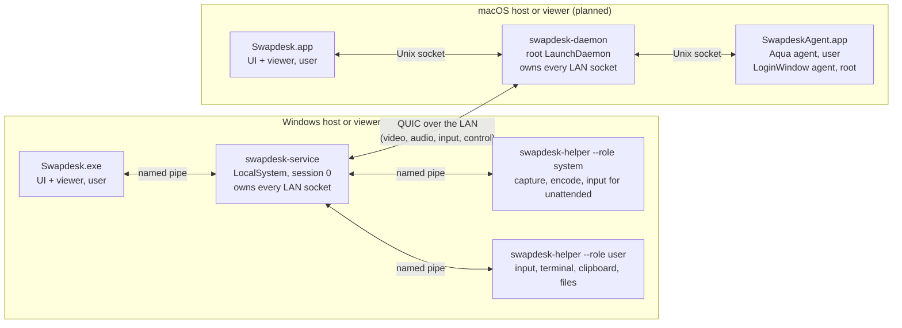

# Swapdesk

A remote desktop that works only on your local network, for Windows and macOS, in every direction: Windows to Windows, Windows to Mac, Mac to Windows and Mac to Mac. Written in Rust with a native interface on each OS. Licensed MIT OR Apache-2.0.

> **Status: Windows preview (v0.1.0-preview), macOS viewer in progress.** Screen, system audio, mouse and keyboard work between two Windows instances on one PC, with pairing, swap, chat, Wake-on-LAN and reconnect. A Mac has paired with a Windows PC's installed service and decoded its screen across a real LAN, driven by a test harness; the Mac app itself is not finished. Terminal, files and clipboard exist as tested libraries but are not in the app yet. See [Status](#status) and [Try the preview](#try-the-preview-windows).

## What it is and why

AnyDesk and TeamViewer reach your machines through a cloud. Swapdesk is for the case where both machines are yours and on the same LAN, and nothing should leave it.

The goal for version 1 (from [docs/SPEC.md](docs/SPEC.md)): screen, system audio, mouse, keyboard, terminal, files, clipboard, chat, Wake-on-LAN and unattended access between two machines. Either machine can host or control. "Request swap" inverts the roles when the other side accepts.

Swapdesk has no relay, no cloud, no NAT traversal and no account. Anything beyond the LAN is explicitly out of scope, not just unbuilt.

## Try the preview (Windows)

Requirements: two Windows 10 or 11 PCs (x64) on the same local network, set as a **Private** network (the firewall rules the installer adds cover Private and Domain profiles only).

On each PC:

1. Download `Swapdesk-windows-x64-0.1.0-preview.zip` from the [releases](https://github.com/devBertini/swapdesk/releases) page and check its SHA-256 against the `.sha256` file next to it.
2. Unzip it, read `install.ps1` if you like (every change is listed in its header), and double-click `install.cmd`. Approve the Windows (UAC) prompt. It installs to `%ProgramFiles%\Swapdesk`, registers the `SwapdeskService` service, adds the firewall rules (UDP 47820, 47821 and mDNS 5353, local subnet only) and a Start menu shortcut.
3. Open **Swapdesk** from the Start menu. The other PC appears under "Na rede" (or type its IPv4 address in "Adicionar por endereço"). Pair them: both screens show the same code; confirm it on both.

`uninstall.cmd` in the same folder removes everything and checks that nothing is left. `install.cmd -DryRun` and `uninstall.cmd -DryRun` print every action without doing any.

The binaries are not code-signed (decision D22: no paid certificate). Windows SmartScreen may warn about an unknown publisher, and Smart App Control may block unsigned programs on some PCs; on the maintainers' PC, with Smart App Control on, the installed preview ran. Building from source is always an option (see below). The interface is in Brazilian Portuguese and English: it starts in Portuguese when the Windows display language is Portuguese and in English otherwise; Settings switches it for the running session (the choice is not kept across restarts yet).

## Status

Each feature is in one of three states, written conservatively:

- **Between machines:** proven on two separate computers on a real LAN.
- **One PC:** proven on one Windows PC, two instances talking over loopback or through the installed service.
- **Planned:** designed, not built, or built only as a library that the app does not use yet.

| Feature | Windows | macOS |
|---|---|---|
| Pairing by compared code, pinned keys | Between machines (as host, with a Mac) | Between machines (as viewer, test harness) |
| Screen (capture, H.264 encode, transport, decode) | Between machines (as host); One PC (as viewer) | Between machines (as viewer, decode only; the window is not finished) |
| System audio | One PC; datagrams reached a Mac | Planned (playback built, not run between machines) |
| Mouse and keyboard | One PC; pointer moves from a Mac reached the PC | Planned (capture built, not run between machines) |
| Discovery on the LAN (DNS-SD) and the LAN guard | One PC | Built, not run between machines |
| Swap, chat, Wake-on-LAN, reconnect | One PC | Planned |
| Terminal, files, clipboard, quick actions | Planned (libraries tested, not in the app) | Planned |
| Macs as host | n/a | Planned |
| Unattended access (login screen, lock screen, UAC) | Planned | Planned (logged-in and unlocked only, by macOS rules) |
| Installer | Preview install and uninstall scripts | Planned |
| Security review, fuzzing, long soak | Planned | Planned |

Fixed since the v0.1.0 preview, in the next release: the "Adicionar por endereço" field now draws and takes typing in the real window, and the viewer's memory stays flat while it decodes (77 to 79 MB over 10 minutes at 1080p60, where it used to grow about 0.17 MB/s).

Notes:

- **Between machines:** the project has one Windows PC and one Mac. Mac to Windows is the first pair being proven; Windows to Windows across two machines and Mac to Mac are not verified ([docs/SPEC.md](docs/SPEC.md), "Later").
- **macOS code** is written on a Windows PC and built and tested on a Mac over SSH.
- The flow-by-flow proof map is [docs/FLUXOS.md](docs/FLUXOS.md).
- **Dependencies:** the project keeps a small, audited set of third-party crates; transport and cryptography stay on `quinn`, `rustls` and `ring` ([docs/DECISIONS.md](docs/DECISIONS.md), D28).

## How it stays on the LAN

This is enforced in code, not left to configuration ([docs/SPEC.md](docs/SPEC.md) F-FIND-02, [docs/PROTOCOL.md](docs/PROTOCOL.md) section 1):

- Physical Ethernet and Wi-Fi interfaces only. Virtual interfaces (WSL, Hyper-V, Docker), VPNs and tunnels are never announced on, browsed on or accepted on.
- A connection is refused before the TLS handshake unless the peer address is on-link in the subnet of the interface it arrived on, and is not loopback or one of this machine's own addresses.
- QUIC packets are sent with IP TTL (hop limit) 1, so they cannot be routed off the subnet. mDNS keeps TTL 255, as link-local multicast requires.
- A manually typed address is accepted only if it is on-link.
- No relay, no cloud and no NAT traversal exist in the design.

## Security in brief

Full detail is in [docs/THREAT-MODEL.md](docs/THREAT-MODEL.md).

- **Pairing by comparing a 6-digit code.** Both users open "Parear" within 2 minutes. Both screens show the same code, derived from a commitment exchange and both keys (ZRTP-style, RFC 6189 argument). A key is pinned only after both users confirm the codes match. Three failed attempts in 15 minutes lock pairing for 15 minutes. The design numbers marked GUESS in the spec are still to be confirmed by measurement.
- **Pinned keys.** Each machine has one Ed25519 device key. Sessions use TLS 1.3 with mutual authentication and only pinned keys. No session tickets and no 0-RTT are accepted, and the key is checked again after every handshake.
- **Permissions per device and direction.** `VIEW`, `CONTROL`, `AUDIO`, `TERMINAL`, `ADMIN_TERMINAL`, `FILES`, `CLIPBOARD`, `UNATTENDED`. A newly paired device has none, so every session prompts the host's user until more is granted.
- **Admin-only unattended access.** Granting `UNATTENDED` or `ADMIN_TERMINAL` needs a local administrator (UAC elevation on Windows, an authorization right on macOS), checked by the privileged service, never by the interface.
- The private key stays in the privileged service. The viewer, the terminal and file access run as the logged-in user, never as SYSTEM or root.

Report vulnerabilities as described in [SECURITY.md](SECURITY.md).

## Architecture



The service or daemon owns every LAN socket in both roles, so the private key never leaves it and the LAN guard lives in one place. On the viewer side, media reaches the interface over local IPC. Details, privilege boundaries and the media pipelines are in [docs/ARCHITECTURE.md](docs/ARCHITECTURE.md). The wire format is [docs/PROTOCOL.md](docs/PROTOCOL.md).

## Build and test (Windows)

Requirements:

- Rust stable, as pinned by [rust-toolchain.toml](rust-toolchain.toml) (channel `stable`, with `rustfmt` and `clippy`). The workspace sets `rust-version = "1.99"` and edition 2024 in [Cargo.toml](Cargo.toml).
- Visual Studio 2022 Build Tools and the Windows SDK.
- [cargo-nextest](https://nexte.st/): `cargo install cargo-nextest`.
- The `opus` crate builds libopus. The project plan notes that CMake is involved and that a long build path can break it on Windows, so use a short `CARGO_TARGET_DIR` if a build fails on path length.

```sh
cargo nextest run --workspace          # the unit tests
cargo build --release                  # UI, helpers (panic = abort)
cargo build -p swapdesk-service --profile release-service   # service (panic = unwind)
```

The service is built with its own profile because it must isolate a panic to one session, while the interface and helpers abort (decision D15 in [docs/DECISIONS.md](docs/DECISIONS.md)).

### Development mode

The real service runs as LocalSystem under the Service Control Manager and needs the elevated install in [packaging/windows](packaging/windows/README.md). For development, run the same code as your own user.

```sh
# terminal 1: a development service (stop it by typing "stop", or creating a file named "stop" in its dev folder)
swapdesk-service --console [--instance N] [--dev-loopback]

# terminal 2: the interface (a development build), told which process to trust as the service
Swapdesk.exe --instance N --service-pid <pid of that swapdesk-service>
```

- `--console` runs without the SCM, with its stores and trace log under `%LOCALAPPDATA%\Swapdesk-dev\<instance>`, and starts helpers from its own folder.
- `--instance N` (0 to 99) lets several development copies share one PC. Pipe names get the suffix `-N` and both UDP ports move up by `10 * N`.
- `--dev-loopback` listens on 127.0.0.1 only and accepts loopback peers, so two instances on one PC can talk. Never use it on a machine that should be reachable.
- `Swapdesk.exe --service-pid` and `--instance` exist only in development builds: a plain `cargo build` (debug) has them, and a release build has them only with `cargo build --release -p swapdesk-app --features dev`. In a normal release they are unknown arguments (the program prints the accepted ones and exits with code 2), so a shipped interface always trusts the service the SCM reports.
- `Swapdesk.exe --service-pid <pid>` makes the interface accept that process as the pipe server instead of the service the SCM reports. `Swapdesk.exe --mock <scenario>` (development builds) runs the interface against a scripted backend.

In this mode the system helper does not have secure-desktop reach, because it runs as your user. Source: [crates/swapdesk-service/src/main.rs](crates/swapdesk-service/src/main.rs) and [crates/swapdesk-app/src/cli.rs](crates/swapdesk-app/src/cli.rs).

### Unsigned builds and Windows Smart App Control

Windows Smart App Control (and App Control for Business) can block unsigned executables, including freshly built test binaries (os error 4551). Release binaries will be unsigned until a signing path is chosen. Decision D22: no paid certificate or signing service. The free options under study are free code signing for open-source projects, a Microsoft Store package signed by Microsoft, and building from source. None is settled. For development, see the recovery recipe in [CONTRIBUTING.md](CONTRIBUTING.md).

### macOS

The macOS crates (`*-mac`) are built and tested on a Mac with Xcode installed. The macOS interface is AppKit through the objc2 crates; the host side will be a root daemon plus per-user agents. Because of Apple's rules, source builds are expected to show the periodic Screen Recording prompt, unless the project's Persistent Content Capture entitlement request is granted (decision D3, [docs/research/macos.md](docs/research/macos.md)).

## Repository layout

Crates live in `crates/`. Only the platform crates (`*-win`, `*-mac`) contain `unsafe`; the workspace forbids it everywhere else. Crate names and traits are fixed in [docs/CONTRACTS.md](docs/CONTRACTS.md).

| Crate | What it holds |
|---|---|
| `swapdesk-proto` | The wire protocol types and codec. No OS, no I/O, no `unsafe`. |
| `swapdesk-platform` | The traits platform crates implement (capture, codec, input, audio, and so on). |
| `swapdesk-lan` | LAN guard, DNS-SD discovery, socket setup (TTL 1), Wake-on-LAN packet. |
| `swapdesk-trust` | Device identity, pairing, TLS setup, trust store, lockout, audit log format. |
| `swapdesk-session` | Control stream state machine, permission enforcement, presence, resume. |
| `swapdesk-video` | Video sender and receiver over QUIC, staleness, rate control, keyframe requests. |
| `swapdesk-audio` | Opus encode and decode, jitter buffer, audio packets. |
| `swapdesk-keys` | Key tables between HID, Windows and macOS keys. |
| `swapdesk-swap` | The swap state machine (request, accept, reverse session). |
| `swapdesk-term` | Terminal and quick-action relay, terminal open policy and consent. |
| `swapdesk-termview` | Terminal model: VT parser, cell grid, scrollback, selection, key encoding. |
| `swapdesk-files` | File transfer with resume, SHA-256 check, safe receiving, remote folder listing. |
| `swapdesk-extras` | Clipboard sync, chat, Wake-on-LAN sender, reconnect policy. |
| `swapdesk-ipc` | The local message set and framing between service, helpers and interface. |
| `swapdesk-host` | OS-free process logic of the helper loop and the service relays. |
| `swapdesk-ui` | Interface state, command API, strings (pt-BR, en), design tokens, accessibility tree. |
| `swapdesk-fakes` | Test fakes: synthetic screen, recording input sink, sine source, log capture, and others. |
| `swapdesk-netsim` | A UDP socket wrapper that injects loss, delay and reordering for tests. |
| `swapdesk-crossdrive` | Test harness for runs between two machines. |
| `swapdesk-net-win`, `swapdesk-net-mac` | Network interface listing (physical only), network category and firewall checks. |
| `swapdesk-secret-win`, `swapdesk-secret-mac` | Secret store: DPAPI plus folder permissions on Windows, the keychain on macOS. |
| `swapdesk-sys-win` | Windows service control, helper launch, named pipes and their ACLs, session watcher, trace log. |
| `swapdesk-capture-win` | Screen capture with Desktop Duplication. |
| `swapdesk-codec-win`, `swapdesk-codec-mac` | H.264 with Media Foundation and NVENC on Windows, VideoToolbox on macOS. |
| `swapdesk-render-win`, `swapdesk-render-mac` | Video renderer: DirectComposition swap chain on Windows, sample buffer layer on macOS. |
| `swapdesk-input-win`, `swapdesk-input-mac` | Input injection and the keyboard grab (`SendInput` and a low-level hook; a CGEventTap). |
| `swapdesk-audio-win`, `swapdesk-audio-mac` | System audio: WASAPI loopback and playback; Core Audio playback. |
| `swapdesk-shell-win`, `swapdesk-shell-mac` | The native shells: Win32 with Direct2D, AppKit. |
| `swapdesk-core-mac` | The in-process service core of the macOS app until the macOS daemon exists. |
| `swapdesk-service` | Binary: the Windows service (and the `--console` development mode). |
| `swapdesk-helper` | Binary: the session helper started by the service. |
| `swapdesk-app` | Binary: `Swapdesk.exe`, the interface and viewer. |

Other folders: `packaging/windows/` (the install scripts), `probes/mac/` (the MacBook probe).

## Documentation

Start at [docs/README.md](docs/README.md), the index of the docs folder.

- [docs/SPEC.md](docs/SPEC.md): version 1 flows, budgets, threats, risks.
- [docs/ARCHITECTURE.md](docs/ARCHITECTURE.md): processes, IPC, media pipelines.
- [docs/THREAT-MODEL.md](docs/THREAT-MODEL.md): assets, attackers, mitigations, what is unproven.
- [docs/PROTOCOL.md](docs/PROTOCOL.md): the wire protocol.
- [docs/DECISIONS.md](docs/DECISIONS.md): why things are the way they are.
- [CONTRIBUTING.md](CONTRIBUTING.md), [SECURITY.md](SECURITY.md), [CODE_OF_CONDUCT.md](CODE_OF_CONDUCT.md).

## License

Dual licensed under either of

- Apache License, Version 2.0 ([LICENSE-APACHE](LICENSE-APACHE))
- MIT license ([LICENSE-MIT](LICENSE-MIT))

at your option.

Unless you explicitly state otherwise, any contribution intentionally submitted for inclusion in this project by you, as defined in the Apache-2.0 license, shall be dual licensed as above, without any additional terms or conditions.
