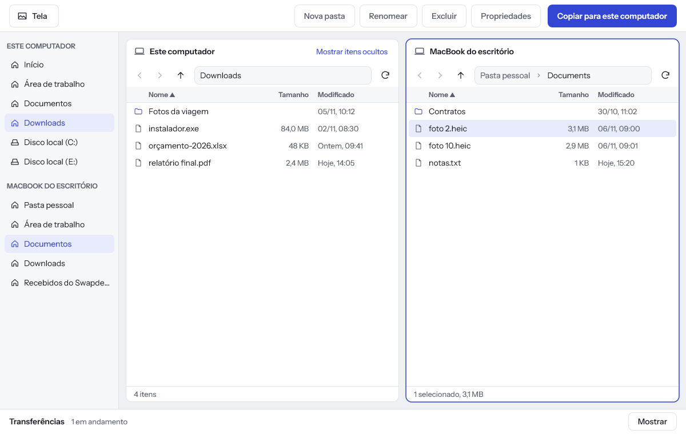
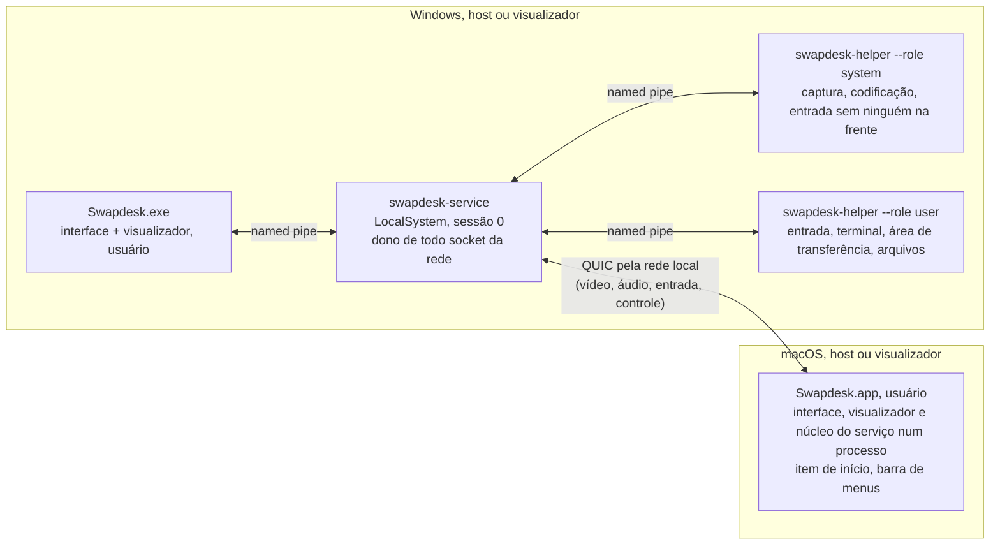

# Swapdesk

[English](README.md) · **Português (Brasil)**

Um acesso remoto que funciona só na sua rede local, para Windows e macOS, feito para todas as direções: Windows com Windows, Windows com Mac, Mac com Windows e Mac com Mac. Escrito em Rust, com interface nativa em cada sistema. Licença MIT OU Apache-2.0.

> **Status: versão 1.1.0.** Um PC com Windows e um Mac se controlam numa rede local de verdade depois de parear por um código comparado, nos dois sentidos: tela, áudio do sistema, mouse, teclado, área de transferência, um explorador de arquivos com os dois computadores lado a lado, terminal e ações rápidas, chat, inversão e reconexão depois de uma queda do link, tudo provado entre as duas máquinas. Entre dois PCs com Windows tudo roda também, provado com duas instâncias num mesmo PC. O app se atualiza pelas releases do GitHub com um clique seu, e cada conta do Windows tem o seu próprio Swapdesk. O que não está na 1.1 está em [Próximos passos](#próximos-passos); a prova de cada recurso está em [Status](#status).

<p>
  
  
  
</p>

## O que é e por quê

AnyDesk e TeamViewer chegam às suas máquinas por uma nuvem. O Swapdesk é para quando as duas máquinas são suas, estão na mesma rede local, e sua tela, teclado e arquivos nunca devem sair dela.

O objetivo da versão 1 (de [docs/SPEC.md](docs/SPEC.md)): tela, áudio do sistema, mouse, teclado, terminal, arquivos, área de transferência, chat, Wake-on-LAN e acesso sem ninguém na frente da máquina, entre dois computadores. Qualquer um dos dois pode hospedar ou controlar. "Inverter" troca os papéis quando o outro lado aceita.

O Swapdesk não tem relay, nuvem, travessia de NAT nem conta. Na 1.x nenhuma sessão, pareamento ou descoberta sai da rede local, e o código garante isso ([Como ele fica na rede local](#como-ele-fica-na-rede-local)). A única requisição que sai da rede local é a procura por uma versão nova, um pedido HTTPS simples ao GitHub que você pode desligar ([Atualizações](#atualizações)). Acesso de fora da rede local é uma direção possível para depois, ainda não projetada: se vier, vem como um modo que você liga, e só rede local continua sendo o padrão ([docs/DECISIONS.md](docs/DECISIONS.md), D36).

## Download

Baixe o zip do seu sistema na [última versão](https://github.com/devBertini/swapdesk/releases/latest): Windows 10 ou 11 (x64) ou macOS 14 ou mais novo (Apple silicon). Cada zip tem um arquivo `.sha256` ao lado, e o workflow de release publica uma atestação de origem do build. Com o [GitHub CLI](https://cli.github.com/) você confere que o zip foi gerado a partir deste repositório:

```sh
gh attestation verify Swapdesk-windows-x64-1.1.0.zip -R devBertini/swapdesk
```

## Instalar no Windows

Requisitos: Windows 10 ou 11 (x64) numa rede local definida como **Privada** (as regras de firewall que o instalador cria cobrem só os perfis Privado e Domínio).

1. Baixe `Swapdesk-windows-x64-1.1.0.zip` na página de [releases](https://github.com/devBertini/swapdesk/releases) e confira o SHA-256 com o arquivo `.sha256` ao lado.
2. Descompacte, leia o `install.ps1` se quiser (cada mudança está listada no cabeçalho dele) e dê dois cliques em `install.cmd`. Aprove o aviso do Windows (UAC). Ele instala em `%ProgramFiles%\Swapdesk`, registra o serviço `SwapdeskService`, cria as regras de firewall (UDP 47820 a 47883 e mDNS 5353, só para a sub-rede local: cada conta do Windows que usa o Swapdesk ganha o seu próprio par de portas, a partir de 47820 e 47821, para até 32 contas) e um atalho no menu Iniciar.
3. Abra o **Swapdesk** pelo menu Iniciar.

O `uninstall.cmd` na mesma pasta remove tudo e confere que nada ficou para trás. `install.cmd -DryRun` e `uninstall.cmd -DryRun` mostram cada ação sem executar nenhuma.

Os binários não são assinados (decisão D22: sem certificado pago). O SmartScreen do Windows pode avisar sobre um editor desconhecido, e o **Smart App Control bloqueia programas não assinados**: num PC em que ele está ligado, o Swapdesk não abre até que ele seja desligado (Segurança do Windows > Controle de aplicativos e do navegador > Smart App Control). Atualizações recentes do Windows permitem religá-lo ali sem reinstalar o sistema.

## Instalar no macOS

Requisitos: macOS 14 ou mais novo, em Apple silicon.

1. Baixe `Swapdesk-macos-arm64-1.1.0.zip` na página de [releases](https://github.com/devBertini/swapdesk/releases), confira o SHA-256, descompacte e mova o **Swapdesk** para Aplicativos.
2. O app é assinado com o certificado do próprio projeto ("Swapdesk Release"), não com um Apple Developer ID (decisão D22), então o macOS recusa a primeira abertura. Abra uma vez, vá em Ajustes do Sistema > Privacidade e Segurança, encontre a linha dizendo que o Swapdesk foi bloqueado e clique em **Abrir Mesmo Assim**. O certificado é o mesmo em todas as versões, então uma atualização mantém as permissões que você deu.
3. Permita o que ele pedir: **Rede Local** (para achar e alcançar o outro computador) e, para este Mac ser controlado, **Gravação do Áudio do Sistema e da Tela** e **Acessibilidade**. Para controlar outro computador a partir do Mac, também **Monitoramento de Entrada**.

Na primeira vez que é aberto, o Swapdesk se adiciona aos itens que abrem no início de sessão e fica na barra de menus quando a janela é fechada, então o Mac pode ser alcançado enquanto você estiver com a sessão aberta. O interruptor "Abrir ao ligar o computador", em Ajustes, tira o Swapdesk dos itens de início de sessão e o coloca de volta. Da 1.1 em diante, as atualizações mantêm as permissões; instalar a 1.1 por cima da 1.0 pede as permissões mais uma vez.

Para desinstalar no macOS: escolha "Sair do Swapdesk" no item dele na barra de menus, remova o Swapdesk de Ajustes do Sistema > Geral > Itens de Início de Sessão e Extensões e de cada lista em Privacidade e Segurança, mova o app de Aplicativos para o Lixo e apague `~/Library/Application Support/Swapdesk` (a chave do dispositivo, os dispositivos pareados e o log).

## Atualizações

A versão 1.0 não se atualiza sozinha. Instale a 1.1.0 à mão uma vez: no Windows, rode o `install.cmd` do novo zip (ele atualiza no lugar); no Mac, substitua o app em Aplicativos e permita de novo as permissões (a 1.0 foi assinada de um jeito que o macOS não reconhece entre versões). A partir da 1.1.0, o Swapdesk avisa quando sai uma versão nova e a instala com um clique.

- **O que é pedido, e quando.** Alguns minutos depois de abrir, e depois uma vez por dia, o Swapdesk baixa um arquivo pequeno da versão mais recente do repositório no GitHub: o manifesto da versão e a sua assinatura. O pedido não leva versão, sistema, cookie nem identificador seu ou do computador. No Windows quem pergunta é o serviço, uma vez pela máquina toda; no Mac, o app. Uma procura que falha fica em silêncio e espera o dia seguinte.
- **Nada se instala sozinho.** Uma versão nova aparece como um cartão na tela inicial; ela só é baixada e instalada quando alguém aperta "Atualizar agora" neste computador, ou por uma sessão. Com uma sessão aberta, o Swapdesk primeiro pede para encerrá-la.
- **O que é conferido.** O manifesto é assinado com a chave de versões do Swapdesk, que fica fora do GitHub: um manifesto ou pacote sem essa assinatura é apagado e nada é instalado, mesmo que a conta do GitHub fosse tomada. O pacote precisa ter o tamanho e o SHA-256 que o manifesto assinado indica, e nunca é instalada uma versão menor ou igual à que está rodando.
- **Se a versão nova não abrir.** No Windows os arquivos antigos ficam guardados até o novo serviço confirmar que iniciou; no Mac o app antigo espera ao lado do novo. Nos dois, uma versão que não inicia em um minuto é trocada pela que estava rodando, e não é oferecida de novo por conta própria.
- **Para desligar.** Ajustes > Atualizações > "Procurar novas versões no GitHub". Com o interruptor desligado, o Swapdesk não envia nada; "Procurar agora" pergunta uma vez. A página de [versões](https://github.com/devBertini/swapdesk/releases) continua sendo o caminho para instalar à mão.

## Atualizando da 1.0

Cada conta do Windows agora tem o seu próprio Swapdesk: pareamentos, permissões, ajustes e atividade. Ao atualizar, todas as contas começam vazias: os pareamentos feitos antes da 1.1 não passam para as contas. Em cada outro computador, esqueça a entrada antiga deste (ou escolha Parear nela) e pareie de novo com a conta que você usa; libere "Entrar sem perguntar" de novo onde quiser. Voltar para a 1.0 devolve os pareamentos antigos como estavam.

## Primeira conexão

Abra o Swapdesk nos dois computadores. O outro computador aparece em "Na rede"; se não aparecer, digite o IPv4 dele em "Adicionar por endereço", seguido de `:porta` quando o Swapdesk dele escuta em outra porta que não a 47820 (uma conta que não seja a primeira de um computador Windows escuta), e veja [docs/FAQ.md](docs/FAQ.md). Um computador ainda na 1.0 não consegue digitar a porta, então por endereço ele alcança só a primeira conta de um computador Windows com a 1.1; pela lista "Na rede" ele alcança todas as contas. Pareie os dois: as duas telas mostram o mesmo código de 6 dígitos; confirme nas duas. Depois conecte: o computador que vai ser controlado pede que o usuário dele aceite, e o que foi concedido fica guardado por dispositivo. Um computador Windows com várias contas mostra cada conta que pareou como um dispositivo próprio, chamado "<nome do computador> · <nome da conta>" (editável em Ajustes), e um computador é pareado com uma conta, nunca com a máquina inteira.

A interface está em português do Brasil e em inglês: ela segue o idioma do sistema, e os Ajustes trocam o idioma.

## Status

Cada recurso está num de três estados, escritos com cautela:

- **Entre máquinas:** provado em dois computadores separados numa rede local de verdade (um PC com Windows e um MacBook), por um harness de testes sobre o código de host e visualizador que é distribuído, em 13/11/2026.
- **Um PC:** provado num PC com Windows, duas instâncias conversando por loopback ou pelo serviço instalado.
- **Construído:** construído e coberto por testes de unidade e integração, ainda não provado num aparelho real para esse caso.

| Recurso | Mac controla Windows | Windows controla Mac | Windows com Windows |
|---|---|---|---|
| Pareamento por código comparado, chaves fixadas | Entre máquinas | Entre máquinas | Um PC |
| Tela (H.264, ou HEVC quando os dois lados têm o hardware) | Entre máquinas | Entre máquinas | Um PC |
| Áudio do sistema, mouse, teclado | Entre máquinas | Entre máquinas | Um PC |
| Área de transferência (texto e imagens) | Entre máquinas | Entre máquinas | Um PC |
| Explorador de arquivos: os dois computadores lado a lado, cópia nos dois sentidos, arrastar e soltar, os discos do outro computador, nova pasta, renomear, mover, a lixeira dele | Entre máquinas (cópia, cancelar) | Entre máquinas (cópia, cancelar) | Um PC |
| Terminal como o usuário do host, ações rápidas | Entre máquinas | Entre máquinas | Um PC |
| Chat com confirmação de leitura | Entre máquinas | Entre máquinas | Um PC |
| Inversão (em menos de 1 s, sem novo pareamento) | Entre máquinas | Entre máquinas | Um PC |
| Reconexão depois de 10 s sem Wi-Fi | Entre máquinas | Entre máquinas | Um PC |
| Atualizações pelas releases do GitHub, assinadas | Construído | Construído | Um PC |
| Contas: um Swapdesk por conta do Windows | n/a | n/a | Um PC |
| Sem ninguém na frente no Windows (tela de entrada, tela bloqueada, UAC), depois de "Elevar controle" | Construído, não provado num reinício real | n/a | Construído |
| Instalador com entrada na lista de apps instalados | Construído, não provado numa máquina limpa | n/a | Construído |

**Na interface, os dois apps usam um só renderizador:** tela Início, guia do primeiro uso, ícone na bandeja do Windows e na barra de menus do Mac, barra da sessão que recolhe numa alça, Ajustes com os dispositivos bloqueados, e toda espera mostrando o que espera e o tempo que falta. Uma revisão de segurança de toda a superfície rodou antes da 1.1.0 ([docs/THREAT-MODEL.md](docs/THREAT-MODEL.md)). Windows com Windows em dois PCs separados e Mac com Mac não estão verificados: o projeto tem um PC e um Mac. O mapa de prova fluxo a fluxo é [docs/FLUXOS.md](docs/FLUXOS.md).

**Dependências:** o projeto mantém um conjunto pequeno de crates de terceiros, conferido no CI por `cargo deny` e `cargo vet`: parte delas se apoia em auditorias públicas importadas de outros projetos (Mozilla, Google, Bytecode Alliance e outros), e o restante é uma lista de isenções que nenhuma auditoria cobre ainda (`supply-chain/`); transporte e criptografia ficam em `quinn`, `rustls` e `ring` ([docs/DECISIONS.md](docs/DECISIONS.md), D28). As licenças delas estão em [THIRD-PARTY-LICENSES.md](THIRD-PARTY-LICENSES.md).

## Próximos passos

A seguir:

- Acesso sem ninguém na frente no Mac dentro do que o macOS permite (com sessão aberta e desbloqueada), e o caminho do Windows provado num reinício real.
- Um segundo PC com Windows para as provas Windows com Windows e o instalador numa máquina limpa.
- Um relatório de desempenho medido (CPU, GPU, memória, cauda de latência) e execuções longas com quedas de Wi-Fi.
- Um loop curto de demonstração no topo deste README.
- Assinatura de código para os dois sistemas quando uma via gratuita servir (decisão D41).

Depois, sem data (D36): acesso de fora da rede local como um modo que você liga, começando por uma VPN que você já usa entre suas máquinas, e grupos de dispositivos. Cada passo tem o seu próprio projeto e modelo de ameaças antes de qualquer código.

## Como ele fica na rede local

Isso é imposto no código, não deixado para configuração ([docs/SPEC.md](docs/SPEC.md) F-FIND-02, [docs/PROTOCOL.md](docs/PROTOCOL.md) seção 1):

- Só interfaces físicas Ethernet e Wi-Fi. Interfaces virtuais (WSL, Hyper-V, Docker), VPNs e túneis nunca são usados para anunciar, procurar ou aceitar conexões.
- Uma conexão é recusada antes do handshake TLS, a não ser que o endereço do outro lado esteja na mesma sub-rede da interface por onde chegou, e não seja loopback nem um dos endereços desta máquina.
- Os pacotes QUIC saem com TTL (hop limit) 1, então não podem ser roteados para fora da sub-rede. O mDNS mantém TTL 255, como o multicast local exige.
- Um endereço digitado à mão só é aceito se estiver na mesma sub-rede.
- Relay, nuvem e travessia de NAT não existem na 1.x.
- A única conexão além da rede local é a procura por atualização: HTTPS para github.com, sem nenhum identificador seu ou da máquina, desligada em Ajustes > Atualizações. Ela não é uma conexão com outro computador; as regras acima não se aplicam a ela, e ela não muda essas regras.

## Segurança em resumo

O detalhamento completo está em [docs/THREAT-MODEL.md](docs/THREAT-MODEL.md) (em inglês).

- **Pareamento comparando um código de 6 dígitos.** Os dois usuários abrem "Parear este computador" em até 2 minutos. As duas telas mostram o mesmo código, derivado de uma troca de compromissos e das duas chaves (no estilo do ZRTP, argumento da RFC 6189). Uma chave só é fixada depois que os dois usuários confirmam que os códigos são iguais. Três tentativas erradas em 15 minutos bloqueiam o pareamento por 15 minutos, e cada novo bloqueio em 24 horas dobra esse tempo, até 24 horas.
- **Chaves fixadas.** Cada conta do Windows e cada usuário do Mac tem a sua própria chave de dispositivo Ed25519. As sessões usam TLS 1.3 com autenticação mútua e só chaves fixadas. Nenhum session ticket e nenhum 0-RTT são aceitos, e a chave é conferida de novo depois de cada handshake.
- **Permissões por dispositivo e por direção.** `VIEW`, `CONTROL`, `AUDIO`, `TERMINAL`, `ADMIN_TERMINAL`, `FILES`, `CLIPBOARD`, `UNATTENDED`. Um dispositivo recém-pareado não tem nenhuma, então cada sessão pede a aceitação do usuário do host até que mais seja concedido.
- **Acesso sem ninguém na frente só com administrador.** Conceder `UNATTENDED` ou `ADMIN_TERMINAL` exige um administrador local (elevação UAC no Windows; para uma conta padrão, um administrador aprova no aviso do UAC na sessão dessa conta e o registro de atividade guarda quem aprovou), conferido pelo serviço privilegiado, nunca pela interface, e o mesmo vale para ampliar o que um dispositivo com `UNATTENDED` pode fazer. Entrar sem perguntar abre a sessão com o alcance do próprio usuário; um botão na sessão ("Elevar controle") amplia esse alcance para a tela de entrada, a tela de bloqueio e os avisos de administrador, depois da confirmação do próprio sistema no computador que controla (UAC no Windows, a senha de administrador no Mac). Pareamento, permissões e conexões de saída ficam reservados à interface da sessão do console. Uma conta só hospeda enquanto está na tela do computador: um dispositivo pareado com a conta A nunca vê nem controla a sessão da conta B. No macOS, o acesso sem ninguém na frente não está na 1.1.
- No Windows a chave privada fica no serviço privilegiado; no macOS ela é um arquivo que só o usuário com a sessão aberta consegue ler (decisão D31). O visualizador, o terminal e o acesso a arquivos rodam como o usuário da sessão, nunca como SYSTEM ou root.

Para relatar vulnerabilidades, siga o [SECURITY.md](SECURITY.md).

## Arquitetura



No Windows o serviço é dono de todo socket da rede nos dois papéis, então a chave privada nunca sai dele e a proteção de rede local fica num lugar só. No macOS, a versão 1 roda o mesmo núcleo de serviço dentro do app, como o usuário da sessão (decisões D27 e D32); um daemon root é trabalho futuro. No lado do visualizador, a mídia chega à interface por IPC local. Detalhes, limites de privilégio e os pipelines de mídia estão em [docs/ARCHITECTURE.md](docs/ARCHITECTURE.md). O formato na rede é o [docs/PROTOCOL.md](docs/PROTOCOL.md). Os dois documentos estão em inglês.

## Compilar a partir do código

Compilar e testar no Windows e no macOS, o modo de desenvolvimento e a organização do repositório estão no [CONTRIBUTING.md](CONTRIBUTING.md) (em inglês).

## Documentação

Comece pelo [docs/README.md](docs/README.md), o índice da pasta de documentos. Os documentos técnicos estão em inglês.

- [docs/SPEC.md](docs/SPEC.md): fluxos, orçamentos, ameaças e riscos da versão 1.
- [docs/ARCHITECTURE.md](docs/ARCHITECTURE.md): processos, IPC, pipelines de mídia.
- [docs/THREAT-MODEL.md](docs/THREAT-MODEL.md): ativos, atacantes, mitigações, o que ainda não foi provado.
- [docs/PROTOCOL.md](docs/PROTOCOL.md): o protocolo de rede.
- [docs/DECISIONS.md](docs/DECISIONS.md): por que as coisas são como são.
- [CONTRIBUTING.md](CONTRIBUTING.md), [SECURITY.md](SECURITY.md), [CODE_OF_CONDUCT.md](CODE_OF_CONDUCT.md).

## Licença

Licenciado, à sua escolha, sob

- Apache License, Version 2.0 ([LICENSE-APACHE](LICENSE-APACHE))
- MIT license ([LICENSE-MIT](LICENSE-MIT))

Salvo declaração explícita em contrário, qualquer contribuição enviada intencionalmente por você para inclusão neste projeto, conforme definido na licença Apache-2.0, será licenciada duplamente como acima, sem termos ou condições adicionais.
