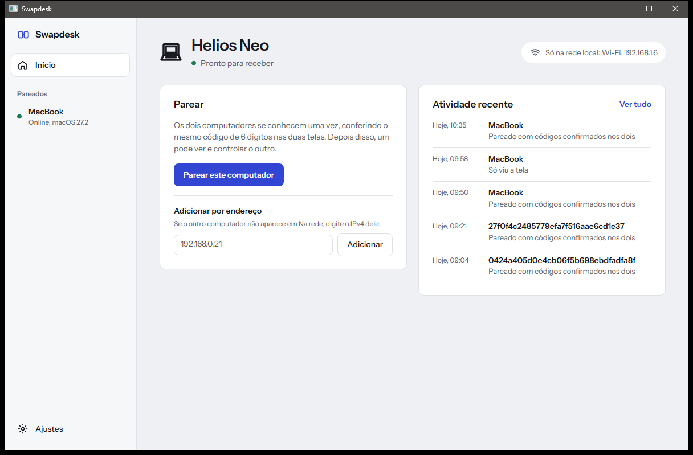
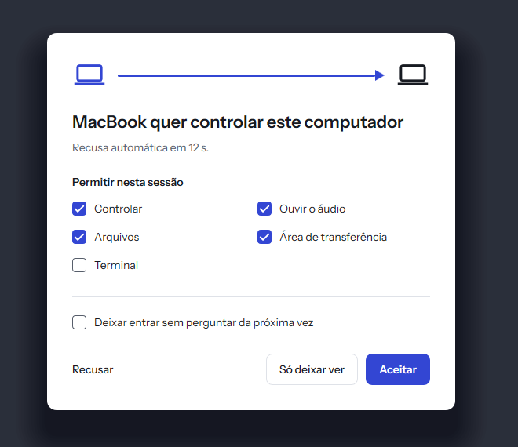
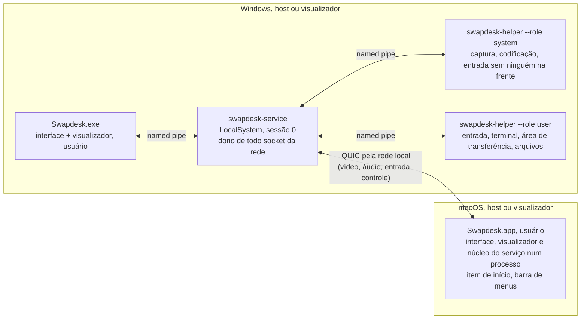

# Swapdesk

[English](README.md) · **Português (Brasil)**

Um acesso remoto que funciona só na sua rede local, para Windows e macOS, feito para todas as direções: Windows com Windows, Windows com Mac, Mac com Windows e Mac com Mac. Escrito em Rust, com interface nativa em cada sistema. Licença MIT OU Apache-2.0.

> **Status: versão 1.0.0.** Um PC com Windows e um Mac se controlam numa rede local de verdade depois de parear por um código comparado: tela, áudio do sistema e mouse nos dois sentidos, e o teclado do Mac para o PC. Entre dois PCs com Windows roda tudo o que está abaixo, incluindo terminal, arquivos, área de transferência, inversão, chat, Wake-on-LAN e reconexão, provado com duas instâncias num mesmo PC. O que não está na 1.0 está em [Fora da 1.0](#fora-da-10); a prova de cada recurso está em [Status](#status).

<p>
  
  
</p>

## O que é e por quê

AnyDesk e TeamViewer chegam às suas máquinas por uma nuvem. O Swapdesk é para quando as duas máquinas são suas, estão na mesma rede local e nada deve sair dela.

O objetivo da versão 1 (de [docs/SPEC.md](docs/SPEC.md)): tela, áudio do sistema, mouse, teclado, terminal, arquivos, área de transferência, chat, Wake-on-LAN e acesso sem ninguém na frente da máquina, entre dois computadores. Qualquer um dos dois pode hospedar ou controlar. "Inverter" troca os papéis quando o outro lado aceita.

O Swapdesk não tem relay, nuvem, travessia de NAT nem conta. Qualquer coisa além da rede local está fora do escopo de propósito, não só por falta de tempo.

## Download

Baixe o zip do seu sistema na [última versão](https://github.com/devBertini/swapdesk/releases/latest): Windows 10 ou 11 (x64) ou macOS 14 ou mais novo (Apple silicon). Cada zip tem um arquivo `.sha256` ao lado, e o workflow de release publica uma atestação de origem do build. Com o [GitHub CLI](https://cli.github.com/) você confere que o zip foi gerado a partir deste repositório:

```sh
gh attestation verify Swapdesk-windows-x64-1.0.0.zip -R devBertini/swapdesk
```

## Instalar no Windows

Requisitos: Windows 10 ou 11 (x64) numa rede local definida como **Privada** (as regras de firewall que o instalador cria cobrem só os perfis Privado e Domínio).

1. Baixe `Swapdesk-windows-x64-1.0.0.zip` na página de [releases](https://github.com/devBertini/swapdesk/releases) e confira o SHA-256 com o arquivo `.sha256` ao lado.
2. Descompacte, leia o `install.ps1` se quiser (cada mudança está listada no cabeçalho dele) e dê dois cliques em `install.cmd`. Aprove o aviso do Windows (UAC). Ele instala em `%ProgramFiles%\Swapdesk`, registra o serviço `SwapdeskService`, cria as regras de firewall (UDP 47820, 47821 e mDNS 5353, só para a sub-rede local) e um atalho no menu Iniciar.
3. Abra o **Swapdesk** pelo menu Iniciar.

O `uninstall.cmd` na mesma pasta remove tudo e confere que nada ficou para trás. `install.cmd -DryRun` e `uninstall.cmd -DryRun` mostram cada ação sem executar nenhuma.

Os binários não são assinados (decisão D22: sem certificado pago). O SmartScreen do Windows pode avisar sobre um editor desconhecido, e o **Smart App Control bloqueia programas não assinados**: num PC em que ele está ligado, o Swapdesk não abre até que ele seja desligado (Segurança do Windows > Controle de aplicativos e do navegador > Smart App Control). Atualizações recentes do Windows permitem religá-lo ali sem reinstalar o sistema.

## Instalar no macOS

Requisitos: macOS 14 ou mais novo, em Apple silicon.

1. Baixe `Swapdesk-macos-arm64-1.0.0.zip` na página de [releases](https://github.com/devBertini/swapdesk/releases), confira o SHA-256, descompacte e mova o **Swapdesk** para Aplicativos.
2. O app é assinado ad hoc, não com um Apple Developer ID (decisão D22), então o macOS recusa a primeira abertura. Abra uma vez, vá em Ajustes do Sistema > Privacidade e Segurança, encontre a linha dizendo que o Swapdesk foi bloqueado e clique em **Abrir Mesmo Assim**.
3. Permita o que ele pedir: **Rede Local** (para achar e alcançar o outro computador) e, para este Mac ser controlado, **Gravação do Áudio do Sistema e da Tela** e **Acessibilidade**. Para controlar outro computador a partir do Mac, também **Monitoramento de Entrada**.

O Swapdesk se adiciona aos itens que abrem no início de sessão e fica na barra de menus quando a janela é fechada, então o Mac pode ser alcançado enquanto você estiver com a sessão aberta. O macOS liga as permissões ao build exato de um app assinado ad hoc: depois de uma atualização, remova o Swapdesk de cada lista em Privacidade e Segurança e permita de novo.

Para desinstalar no macOS: escolha "Sair do Swapdesk" no item dele na barra de menus, remova o Swapdesk de Ajustes do Sistema > Geral > Itens de Início de Sessão e Extensões e de cada lista em Privacidade e Segurança, mova o app de Aplicativos para o Lixo e apague `~/Library/Application Support/Swapdesk` (a chave do dispositivo, os dispositivos pareados e o log).

## Primeira conexão

Abra o Swapdesk nos dois computadores. O outro computador aparece em "Na rede"; se não aparecer, digite o IPv4 dele em "Adicionar por endereço" e veja [docs/FAQ.md](docs/FAQ.md). Pareie os dois: as duas telas mostram o mesmo código de 6 dígitos; confirme nas duas. Depois conecte: o computador que vai ser controlado pede que o usuário dele aceite, e o que foi concedido fica guardado por dispositivo.

A interface está em português do Brasil e em inglês: ela segue o idioma do sistema, e os Ajustes trocam o idioma.

## Status

Cada recurso está num de três estados, descritos de forma conservadora:

- **Entre máquinas:** provado em dois computadores separados numa rede local de verdade (um PC com Windows e um MacBook).
- **Um PC:** provado num PC com Windows, com duas instâncias conversando por loopback ou pelo serviço instalado.
- **Fora da 1.0:** veja [Fora da 1.0](#fora-da-10).

| Recurso | Mac controla Windows | Windows controla Mac | Windows com Windows |
|---|---|---|---|
| Pareamento por código comparado, chaves fixadas | Entre máquinas | Entre máquinas | Um PC |
| Tela (captura, H.264, transporte, decodificação, exibição) | Entre máquinas | Entre máquinas (3420x2214, primeiro quadro em 0,6 s) | Um PC |
| Áudio do sistema | Entre máquinas | Entre máquinas | Um PC |
| Mouse | Entre máquinas | Entre máquinas | Um PC |
| Teclado | Entre máquinas (digitando no Bloco de Notas) | Construído e com testes unitários no Mac, ainda não rodado entre máquinas | Um PC |
| Adicionar por endereço e a proteção de rede local | Entre máquinas | Entre máquinas | Um PC |
| Descoberta na rede local (DNS-SD) | Entre máquinas | Entre máquinas | Um PC |
| Inversão, chat, Wake-on-LAN, reconexão | Fora da 1.0 | Fora da 1.0 | Um PC |
| Terminal, arquivos, área de transferência, ações rápidas | Fora da 1.0 | Fora da 1.0 | Um PC |
| Tela cheia e atalhos do visualizador | Construído | Construído | Um PC |
| Alcançável com a sessão aberta e a janela fechada | n/a | Item de início e barra de menus | Serviço do Windows |
| Sem ninguém na frente (tela de login, tela bloqueada, UAC) | Fora da 1.0 | Fora da 1.0 (o macOS só permite com sessão aberta e desbloqueada) | Fora da 1.0 |

As execuções entre máquinas são conduzidas por um harness de testes sobre o código de host e visualizador que é distribuído, mais uma sessão manual com o Mac controlando o PC. Windows com Windows em dois PCs separados e Mac com Mac não foram verificados: o projeto tem um PC e um Mac. O mapa de prova fluxo a fluxo é o [docs/FLUXOS.md](docs/FLUXOS.md).

**Dependências:** o projeto mantém um conjunto pequeno e auditado de crates de terceiros (`cargo deny` e `cargo vet` no CI); transporte e criptografia ficam em `quinn`, `rustls` e `ring` ([docs/DECISIONS.md](docs/DECISIONS.md), D28). As licenças delas estão em [THIRD-PARTY-LICENSES.md](THIRD-PARTY-LICENSES.md).

## Fora da 1.0

Planejado para a 1.1:

- Inversão, terminal, arquivos e área de transferência entre Windows e Mac (já funcionam de Windows para Windows).
- Acesso sem ninguém na frente no Windows, na tela de login, na tela bloqueada e nos avisos do UAC, provado depois de uma reinicialização real.
- Um teste de 8 horas com quedas de Wi-Fi, com os orçamentos de CPU, GPU e memória medidos nele.
- Troca entre as telas do host, provada em duas telas com escalas diferentes.
- Menos cópias no caminho dos quadros e um layout de texto em cache na interface.
- A próxima rodada da interface: telas, textos, acessibilidade, um ícone na bandeja do Windows e um guia de primeiro uso.
- Um instalador com entrada na lista de aplicativos instalados, e um caminho de assinatura para os dois sistemas.
- Capturas de tela, um relatório de desempenho, fuzzing guiado por cobertura dos decodificadores, um job de CI no Linux.

## Como ele fica na rede local

Isso é imposto no código, não deixado para configuração ([docs/SPEC.md](docs/SPEC.md) F-FIND-02, [docs/PROTOCOL.md](docs/PROTOCOL.md) seção 1):

- Só interfaces físicas Ethernet e Wi-Fi. Interfaces virtuais (WSL, Hyper-V, Docker), VPNs e túneis nunca são usados para anunciar, procurar ou aceitar conexões.
- Uma conexão é recusada antes do handshake TLS, a não ser que o endereço do outro lado esteja na mesma sub-rede da interface por onde chegou, e não seja loopback nem um dos endereços desta máquina.
- Os pacotes QUIC saem com TTL (hop limit) 1, então não podem ser roteados para fora da sub-rede. O mDNS mantém TTL 255, como o multicast local exige.
- Um endereço digitado à mão só é aceito se estiver na mesma sub-rede.
- Relay, nuvem e travessia de NAT não existem no projeto.

## Segurança em resumo

O detalhamento completo está em [docs/THREAT-MODEL.md](docs/THREAT-MODEL.md) (em inglês).

- **Pareamento comparando um código de 6 dígitos.** Os dois usuários abrem "Parear este computador" em até 2 minutos. As duas telas mostram o mesmo código, derivado de uma troca de compromissos e das duas chaves (no estilo do ZRTP, argumento da RFC 6189). Uma chave só é fixada depois que os dois usuários confirmam que os códigos são iguais. Três tentativas erradas em 15 minutos bloqueiam o pareamento por 15 minutos, e cada novo bloqueio em 24 horas dobra esse tempo, até 24 horas.
- **Chaves fixadas.** Cada máquina tem uma chave de dispositivo Ed25519. As sessões usam TLS 1.3 com autenticação mútua e só chaves fixadas. Nenhum session ticket e nenhum 0-RTT são aceitos, e a chave é conferida de novo depois de cada handshake.
- **Permissões por dispositivo e por direção.** `VIEW`, `CONTROL`, `AUDIO`, `TERMINAL`, `ADMIN_TERMINAL`, `FILES`, `CLIPBOARD`, `UNATTENDED`. Um dispositivo recém-pareado não tem nenhuma, então cada sessão pede a aceitação do usuário do host até que mais seja concedido.
- **Acesso sem ninguém na frente só com administrador.** Conceder `UNATTENDED` ou `ADMIN_TERMINAL` exige um administrador local (elevação UAC no Windows), conferido pelo serviço privilegiado, nunca pela interface, e o mesmo vale para ampliar o que um dispositivo com `UNATTENDED` pode fazer. Pareamento, permissões e conexões de saída ficam reservados à interface da sessão do console. No macOS, o acesso sem ninguém na frente não está na 1.0.
- No Windows a chave privada fica no serviço privilegiado; no macOS ela é um arquivo que só o usuário com a sessão aberta consegue ler (decisão D31). O visualizador, o terminal e o acesso a arquivos rodam como o usuário da sessão, nunca como SYSTEM ou root.

Para relatar vulnerabilidades, siga o [SECURITY.md](SECURITY.md).

## Arquitetura



No Windows o serviço é dono de todo socket da rede nos dois papéis, então a chave privada nunca sai dele e a proteção de rede local fica num lugar só. No macOS, a versão 1 roda o mesmo núcleo de serviço dentro do app, como o usuário da sessão (decisões D27 e D32); um daemon root é trabalho futuro. No lado do visualizador, a mídia chega à interface por IPC local. Detalhes, limites de privilégio e os pipelines de mídia estão em [docs/ARCHITECTURE.md](docs/ARCHITECTURE.md). O formato na rede é o [docs/PROTOCOL.md](docs/PROTOCOL.md). Os dois documentos estão em inglês.

## Compilar a partir do código

Compilar e testar no Windows e no macOS, o modo de desenvolvimento e a organização do repositório estão no [CONTRIBUTING.md](CONTRIBUTING.md) (em inglês).

## Documentação

Comece pelo [docs/README.md](docs/README.md), o índice da pasta de documentos. Os documentos técnicos estão em inglês.

- [docs/SPEC.md](docs/SPEC.md): fluxos, orçamentos, ameaças e riscos da versão 1.
- [docs/ARCHITECTURE.md](docs/ARCHITECTURE.md): processos, IPC, pipelines de mídia.
- [docs/THREAT-MODEL.md](docs/THREAT-MODEL.md): ativos, atacantes, mitigações, o que ainda não foi provado.
- [docs/PROTOCOL.md](docs/PROTOCOL.md): o protocolo de rede.
- [docs/DECISIONS.md](docs/DECISIONS.md): por que as coisas são como são.
- [CONTRIBUTING.md](CONTRIBUTING.md), [SECURITY.md](SECURITY.md), [CODE_OF_CONDUCT.md](CODE_OF_CONDUCT.md).

## Licença

Licenciado, à sua escolha, sob

- Apache License, Version 2.0 ([LICENSE-APACHE](LICENSE-APACHE))
- MIT license ([LICENSE-MIT](LICENSE-MIT))

Salvo declaração explícita em contrário, qualquer contribuição enviada intencionalmente por você para inclusão neste projeto, conforme definido na licença Apache-2.0, será licenciada duplamente como acima, sem termos ou condições adicionais.
