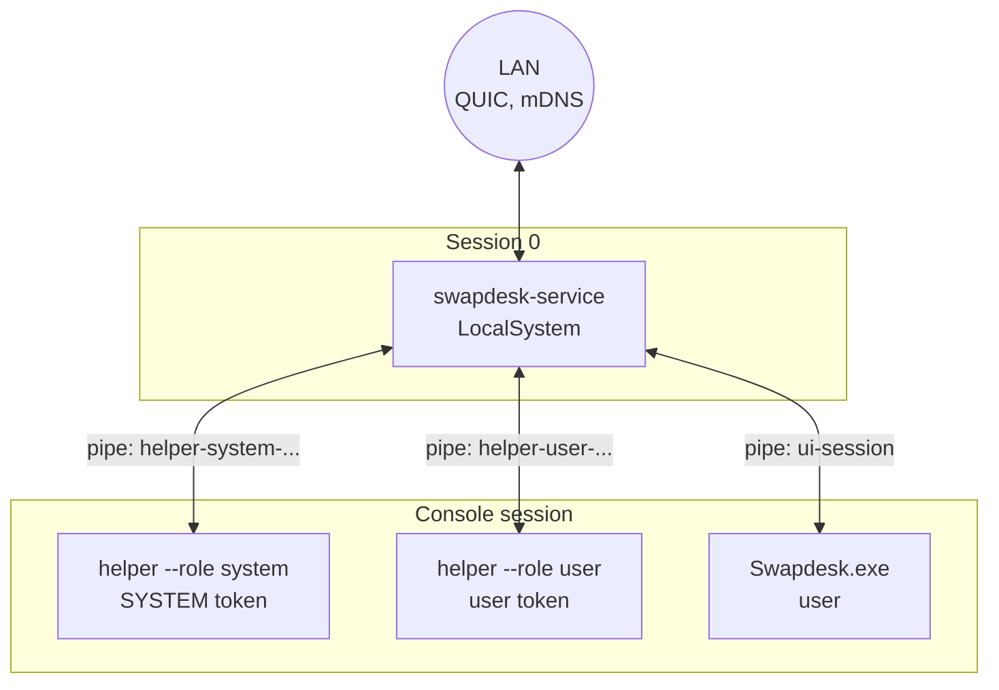
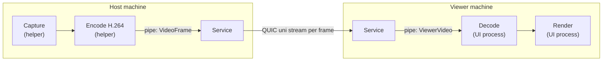

# Architecture

This is a reader's overview. The normative sources are [SPEC.md](SPEC.md) (flows, "Data and architecture"), [CONTRACTS.md](CONTRACTS.md) (C2 processes and IPC, crates) and [PROTOCOL.md](PROTOCOL.md) (the wire). Where this file and those differ, they win. Marks used there: **UNPROVEN** means no primary source settles it yet, **GUESS** means a design number still to confirm.

Status: version 1.1.0 (see the status table in the [README](../README.md)). Windows runs the service, helper and interface processes below. macOS runs everything in one process, Swapdesk.app, as the logged-in user (decisions D27 and D32); the root daemon and agents under "macOS, later" are design.

## Principles

- On Windows the service owns every LAN socket, in both the host and the viewer role (decision D6). The device private key never leaves it, the LAN guard lives in one place, and a session survives a helper restart. On macOS version 1 the same service core runs inside Swapdesk.app, so the app owns the sockets and the key is a file only its user can read (decision D31).
- The viewer always runs as the logged-in user, never as SYSTEM or root. Video from a remote peer is decoded only in that user-level process.
- Anything that needs the user's rights (terminal, files, clipboard, prompted input) runs in a process of the logged-in user.
- No local IPC message carries a file path to the service. The user-level processes open, read and write files and stream bytes.
- The interface never reads the trust store or the logs. It asks the service.

## Processes and privilege boundaries

### Windows (CONTRACTS C2.1)

| Process | Runs as | Does |
|---|---|---|
| `swapdesk-service.exe` | LocalSystem, session 0, started by the Service Control Manager | Every LAN socket (QUIC, mDNS, Wake-on-LAN), LAN guard, device identity and trust store, pairing, permissions, presence, swap, audit log, `SendSAS`, starting and watching the helpers, the administrator terminal. It never captures, decodes, draws a UI or opens a path a client sent. |
| `swapdesk-helper.exe --role system` | SYSTEM token moved to the console session | Screen capture, encode, cursor, display list, desktop-switch watching, and input injection for `UNATTENDED` sessions only. No LAN, files, clipboard or terminals. |
| `swapdesk-helper.exe --role user` | The logged-in user's token (medium integrity) | Input injection for prompted sessions, the user terminal, clipboard, the host side's file access, quick actions. No LAN. |
| `Swapdesk.exe` | The user | The interface (Win32, DirectComposition, Direct2D), prompts, the "being controlled" banner, and the viewer: decode, render, key grab, audio playback, the viewer side's own file access. No LAN, no SYSTEM rights. |

The service starts helpers only from its per-machine install folder under `%ProgramFiles%`, and only if neither the folder nor the helper file is writable by anyone but SYSTEM, Administrators and TrustedInstaller. Helpers that crash are restarted with backoff (1, 2, 4, 8, 16, 30 s); sessions survive a helper restart.

Why two helpers: prompted sessions inject input with the user's medium-integrity token, so elevated windows and UAC are not controllable (decision D11). Only an `UNATTENDED` session, granted by a local administrator, injects as SYSTEM and can reach the login screen, the lock screen and UAC.

### macOS in version 1

| Process | Runs as | Does |
|---|---|---|
| `Swapdesk.app` | The user | Everything: the service core (LAN sockets, pairing, trust store, sessions), the AppKit interface and viewer (VideoToolbox decode, `AVSampleBufferDisplayLayer`, event-tap key grab, audio playback) and the host side (ScreenCaptureKit video and audio, VideoToolbox encode, `CGEventPost` input). Registers itself as a login item with `SMAppService.mainApp` and stays in the menu bar when its window closes, so it keeps hosting while the user is logged in. |

What this costs against the design below: no administrator terminal on the Mac, no access at the login window, and the device key is protected by the user's file permissions rather than by root.

### macOS, later (CONTRACTS C2.2, design only)

| Process | Runs as | Does |
|---|---|---|
| `swapdesk-daemon` | root LaunchDaemon (registered with `SMAppService`) | What the Windows service does, except `SendSAS`. Writes the LoginWindow agent plist when unattended access is on. Checks at start that its own bundle is root-owned and validly signed. Exempt from Local Network privacy as a daemon. |
| `SwapdeskAgent.app` (Aqua instance) | The user | ScreenCaptureKit video and audio, VideoToolbox encode, `CGEventPost` input, cursor, terminal, clipboard, host-side files, quick actions. No LAN. |
| `SwapdeskAgent.app` (LoginWindow instance) | root, from a legacy launch agent plist | Capture and input at the login window, for `UNATTENDED` sessions only, within what the macOS probes allow. No LAN. |
| `Swapdesk.app` | The user | The AppKit interface and the viewer (VideoToolbox decode, `AVSampleBufferDisplayLayer`, event-tap key grab, audio playback). No LAN, no root rights. |

Unattended access on macOS needs macOS 14.4 or later. FileVault pre-boot is out of reach. What works at the login window depends on probes that have not been run yet.

### Updates (version 1.1, D53)

The only traffic beyond the LAN, and not a peer connection ([UPDATES.md](UPDATES.md)):

| Process | Runs as | Does |
|---|---|---|
| `swapdesk-service.exe` (Windows) | LocalSystem | Once per machine, 2 to 10 minutes after the start and then every 24 hours while the switch is on: fetches the signed manifest from github.com through WinHTTP, checks its Ed25519 signature against the compiled release keys, and offers a newer stable version to the console session's interfaces. On a person's click it downloads the package into `%ProgramData%\Swapdesk\update` (SYSTEM and Administrators only), checks its size and SHA-256, stages it and starts the applier. |
| `swapdesk-service.exe --apply-update` (Windows) | LocalSystem, a copy started from `update\applier` | Stops the service and every Swapdesk process of the install folder, keeps the old files, moves the new ones in (reset to the folder's ACL and checked by the install policy), starts the service and restores the old files when the new service does not commit within 60 s; a journal finishes or rolls back an apply cut short. The service then reopens `Swapdesk.exe --after-update` in the sessions that had an interface. |
| `Swapdesk.app` (Mac) | The user | The same check and download in process, through an ephemeral `NSURLSession`, into `~/Library/Application Support/Swapdesk/updates`; the staged bundle must carry the running app's signing identity; it is swapped with the running bundle by `renamex_np(RENAME_SWAP)`. |
| `Swapdesk --update-watch` (Mac) | The user, the old bundle's binary at its hidden path | Waits for the old app to quit, opens the new one, and swaps back when it does not commit within 60 s. |

Development instances (`--instance`, `--console`, `--scratch`) never check and never install. `swapdesk-update` does not depend on the LAN crates, and nothing it receives can open a session or change a grant.

### Local IPC

- **Windows: named pipes** under `\\.\pipe\swapdesk\`, byte mode, remote clients rejected. The UI pipe is created by the service for each interactive session with `FILE_FLAG_FIRST_PIPE_INSTANCE` (a squatted name is detected and no UI pipe is created). Its DACL is explicit: SYSTEM full, the session's user read/write without the right to add instances, nobody else. Helper pipes have a random 128-bit name, and the client PID must equal the PID the service launched. The client checks the server too: the UI opens the pipe with identification-level impersonation and compares the server PID to the one the Service Control Manager reports.
- **macOS: Unix sockets** in a root-owned directory. On accept the daemon takes the peer's audit token (not the PID, which can be recycled) and checks the peer's code signature against a requirement. The client checks that the socket and its directory are root-owned.
- **What the service trusts.** Any process of the logged-in user can act as the interface (it can inject into it or open the pipe itself). So the service treats every UI connection as "this user" and grants only what the user could do by hand. Granting `UNATTENDED` or `ADMIN_TERMINAL`, and using them from this machine on another, needs an elevated connection (a UAC-started `Swapdesk.exe --elevated` instance on Windows, an Authorization Services right on macOS). The service enforces it.
- **Framing and messages.** One message is a varint type, a varint length and a body, reusing the protocol's primitives. Every length is checked against its limit before any allocation, and an unknown type closes the pipe. The message set (service to helper, helper to service, UI requests and notifications, viewer media) is C2.4 in [CONTRACTS.md](CONTRACTS.md), implemented in `swapdesk-ipc`.

Development mode, `swapdesk-service --console`, runs the same code as the current user without the Service Control Manager. See [CONTRIBUTING.md](../CONTRIBUTING.md#development-mode).

## Wire protocol summary

Full text: [PROTOCOL.md](PROTOCOL.md).

- **Transport:** QUIC v1 through `quinn` with `rustls` and the `ring` provider. IPv4 only in version 1.
- **Two endpoints per account** (on Windows each account listens on its own slot's pair of ports, the session port held exclusively on the wildcard address and the arrival address checked against the approved interfaces, `ACCOUNTS.md` 5.5; on the Mac and with one account, per approved interface address), each with its own TLS configuration: the session endpoint (ALPN `swapdesk/1`, pinned keys only, always on while the service runs) and the pairing endpoint (ALPN `swapdesk-pair/1`, open only while this machine is in pairing mode, one connection at a time). Default UDP ports 47820 and 47821 are marked GUESS in the protocol document and are configurable.
- **Identity and TLS:** one Ed25519 device key per machine. TLS 1.3 with mutual authentication. The primary design is RFC 7250 raw public keys; whether `quinn` negotiates them end to end is UNPROVEN, with a self-signed certificate plus key pinning as the fallback. No tickets, no resumption, no 0-RTT. After every handshake the service looks the peer key up in the trust store again before any stream is accepted.
- **Before the handshake:** each incoming connection is checked for being on-link on the interface it arrived on, and not loopback or local. QUIC sockets use TTL 1.
- **Version negotiation:** the major version is in the ALPN, the minor in `Hello`/`HelloAck`.
- **Streams and datagrams** on the session endpoint (the QUIC client is the viewer):

| Carrier | Content |
|---|---|
| First bidirectional stream | Control messages (hello, grants, prompts, display list, swap, resume, keepalive) |
| Unidirectional stream 0x01 | Input records, one long-lived stream per session, viewer to host |
| Unidirectional stream 0x02 | One encoded video frame per stream (32-byte header plus H.264 Annex B), host to viewer, reset when stale |
| Unidirectional stream 0x03 | Cursor shape |
| Unidirectional stream 0x04 | Clipboard item, either direction |
| Unidirectional stream 0x05 | File data |
| Bidirectional stream 0x10 | Terminal bytes |
| Datagram 0x01 | One Opus audio packet |
| Datagram 0x02 | Cursor position |

- **Swap** (decision D1) is not an in-place role change: the old connection closes and the future viewer opens a new session connection with a single-use, 10 second swap token, using the already pinned keys.
- **Resume** after a lost connection uses a single-use token valid for 60 seconds and bound to the device.
- Pairing is a commitment exchange with a 6-digit code over both keys and the TLS exporter, described in [PROTOCOL.md](PROTOCOL.md) section 3.

## Media pipelines

Host and viewer both go through their own service, so there is one local IPC hop on the viewer path. Its cost against the latency budget is risk R9 in the spec.

- **Video.** Windows capture uses DXGI Desktop Duplication on the adapter that owns each display, then conversion to NV12 and H.264 through Media Foundation. For displays on an NVIDIA adapter the encoder is NVENC loaded at runtime from the driver, because the NVIDIA Media Foundation encoder cannot be activated on the development PC (decision D21). Each frame is sent on its own QUIC stream, which the host resets when it goes stale, so a late frame never blocks a newer one. The viewer asks for a keyframe after a gap. The viewer decodes with Media Foundation and renders into a DirectComposition swap chain under the interface's toolbar. The macOS equivalents (ScreenCaptureKit, VideoToolbox, `AVSampleBufferDisplayLayer`) are design only.
- **Audio.** WASAPI loopback capture on the host, Opus at 48 kHz, one packet per QUIC datagram (the oldest is dropped under congestion), a jitter buffer and playback in the viewer. With audio off, nothing is captured or sent (decision D16). Whether loopback from the SYSTEM helper hears the user's audio is risk R6, with audio capture in the user helper as the fallback.
- **Input.** The viewer's interface grabs keyboard and pointer (physical keys as HID usages, or Unicode text for differing layouts) and sends records on the input stream. The host service checks the session's grants, then forwards them to the helper that injects them: the user helper for prompted sessions, the system helper for `UNATTENDED` ones. View-only sessions drop every input event on both sides.
- **Local relay.** The host service relays helper messages to the network and the viewer service relays network streams to the interface, both over the C2.4 message set. The OS-free logic is in `swapdesk-host`.

Performance budgets (B1 to B10, such as median capture-to-present latency of at most 40 ms at 1080p60 on loopback with a synthetic source) are in [SPEC.md](SPEC.md). They are targets; the numbers measured against them, and how each is taken, are in [PERFORMANCE.md](PERFORMANCE.md), and the proof of the flows is in [FLUXOS.md](FLUXOS.md).

## Crate map

The crates table with the stage that creates each crate is in [CONTRACTS.md](CONTRACTS.md). One line per crate is in [CONTRIBUTING.md](../CONTRIBUTING.md#repository-layout). The dependency rules:

- `swapdesk-proto` depends on no OS and does no I/O.
- Platform crates (`*-win`, later `*-mac`) implement the traits of `swapdesk-platform` and are the only crates allowed `unsafe`.
- Logic that tests need lives in library crates. The binaries (`swapdesk-service`, `swapdesk-helper`, `swapdesk-app`) only wire libraries to platform crates.
- `swapdesk-ui` holds the interface state, strings and design tokens once, for both native shells.

## Interface

One native shell per OS (decision D18): Win32 with DirectComposition and Direct2D/DirectWrite on Windows, AppKit on macOS. The earlier Tauri plan was dropped because of WebView2's memory cost (decision D17, measurements in [research/ui.md](research/ui.md)). Screens follow the approved design in [design/](design/) and the responsiveness rules R-UI-1 to R-UI-12 of the spec.
